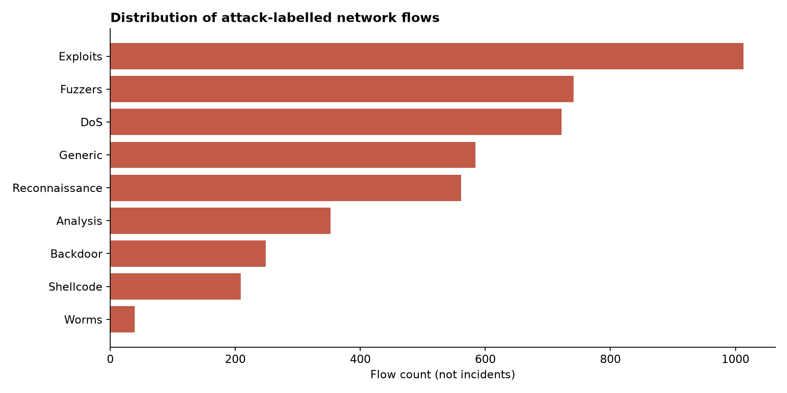
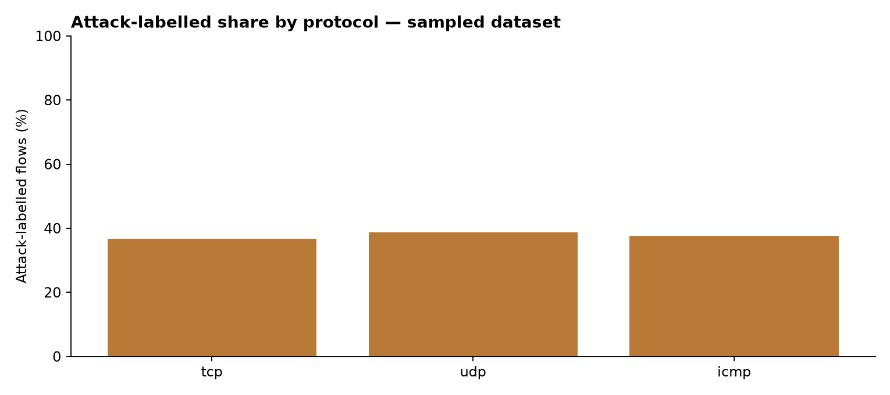

# 🛡️ Cybersecurity Threat Analytics Dashboard

**Exploring attack-labelled network traffic with Python, SQL, and Streamlit**

A data analytics portfolio project that investigates patterns in labelled network flows: common attack categories, protocols, services, traffic rates, and data quality. It converts a cybersecurity benchmark dataset into summary tables, charts, and an interactive dashboard to support exploratory security analysis.

## 📊 Dashboard preview

The following images were generated using **synthetic demonstration data**, not actual UNSW-NB15 records.





## 🎯 Project objectives

- Compare normal and attack-labelled network flows.
- Identify frequent attack categories in the analysed dataset.
- Explore how attack-labelled flow shares differ across network protocols and services.
- Summarise flow duration, data transfer volume, and traffic rate.
- Validate records and report data-quality issues before analysis.
- Communicate findings through a Streamlit dashboard, CSV reports, SQL queries, and charts.

## 🛠️ Technology stack

| Technology | Purpose |
| --- | --- |
| Python | Data processing and analysis |
| Pandas / NumPy | Cleaning, transformation, and aggregation |
| Matplotlib | Exportable charts |
| Plotly / Streamlit | Interactive dashboard |
| SQL | Reusable queries for attack categories, protocols, and services |
| Pytest | Automated testing |

## 📁 Project structure

```text
02-cybersecurity-threat-analytics/
├── app.py                 # Interactive Streamlit dashboard
├── pipeline.py            # Data processing and report generation
├── requirements.txt       # Python dependencies
├── README.md              # Project documentation
├── data/
│   └── demo_flows.csv     # Synthetic data for demonstration
├── outputs/               # Generated cleaned data and summary tables
├── reports/               # Generated PNG charts
├── sql/
│   └── analysis.sql       # SQL analysis queries
└── tests/
    └── test_pipeline.py   # Pipeline tests
```

## 🚀 Getting started

**Requirements:** Python 3.10+ recommended and a terminal (PowerShell on Windows works).

### 1. Clone or download the repository

```powershell
git clone https://github.com/YOUR-USERNAME/02-cybersecurity-threat-analytics.git
cd 02-cybersecurity-threat-analytics
```

Replace `YOUR-USERNAME` with your GitHub username, or open the folder after extracting the ZIP.

### 2. Install dependencies

```powershell
python -m pip install -r requirements.txt
```

### 3. Run the demo analysis

```powershell
python pipeline.py --demo
```

This generates cleaned data, summary tables, and charts from **fictional network-flow data**.

### 4. Open the dashboard

```powershell
python -m streamlit run app.py
```

Use the sidebar to filter by protocol and service. You can also upload an official UNSW-NB15 training or testing CSV in the dashboard.

### 5. Run tests

```powershell
python -m pytest -q
```

## 🧾 Working with a real dataset

The project supports the publicly documented [UNSW-NB15 dataset](https://research.unsw.edu.au/projects/unsw-nb15-dataset), a research benchmark containing normal traffic and simulated attacks in a controlled environment.

1. Download the official **UNSW_NB15_training-set.csv** from the dataset provider.
2. Save it inside the `data` folder.
3. Run:

```powershell
python pipeline.py --input data/UNSW_NB15_training-set.csv
```

The output tables and charts will then be based on the CSV you provided. The dashboard analyses uploaded data separately; upload the same CSV there to view it interactively.

**Dataset citation:** Moustafa, N., & Slay, J. (2015). *UNSW-NB15: a comprehensive data set for network intrusion detection systems*. MilCIS 2015. Refer to the [official source](https://research.unsw.edu.au/projects/unsw-nb15-dataset) for dataset access and citation details.

## 💡 Skills demonstrated

Data cleaning · Exploratory data analysis · Cybersecurity fundamentals · Network-flow interpretation · Python · SQL · Interactive dashboards · Reproducible analysis · Data-quality validation · Technical documentation

